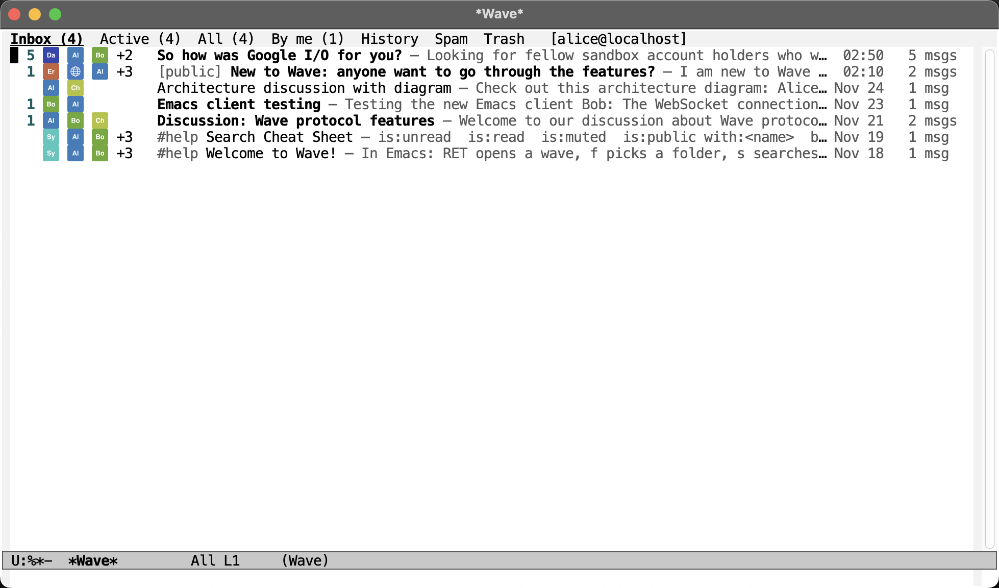
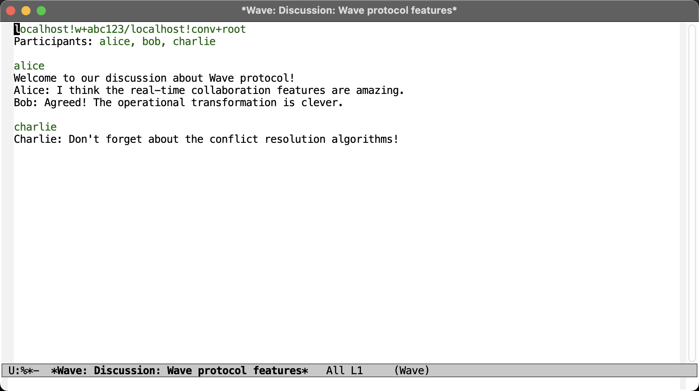

#+TITLE: Wave Client for Emacs
#+AUTHOR: Wave Client Contributors
#+OPTIONS: toc:2

[[https://www.python.org/downloads/][https://img.shields.io/badge/python-3.11+-blue.svg]]
[[https://fastapi.tiangolo.com/][https://img.shields.io/badge/FastAPI-0.116+-green.svg]]
[[https://opensource.org/licenses/Apache-2.0][https://img.shields.io/badge/License-Apache%202.0-blue.svg]]
[[./specs/wave-api.openapi.yaml][https://img.shields.io/badge/OpenAPI-3.0-green.svg]]
[[https://www.gnu.org/software/emacs/][https://img.shields.io/badge/Emacs-30.1-purple.svg]]
[[https://www.freebsd.org/][https://img.shields.io/badge/FreeBSD-14.3-red.svg]]

This repository contains:
1. *Original Wave Emacs Client* - An Emacs Lisp client for Google Wave (historical preservation)
2. *Local Wave Server* - A modern FastAPI implementation for testing and development

[[https://live.staticflickr.com/4023/4639702964_b6fcef2a3f_b.jpg]]

* Quick Start

** Running the Local Server

#+begin_src bash
# Install dependencies
uv sync

# Run the server
uv run wave-client-server

# Or use make
make server
#+end_src

The server runs on =http://localhost:9898= with interactive API docs at =/docs=.

** Using the Emacs Client

Add to your Emacs configuration:

#+begin_src elisp
;; Add to load path
(add-to-list 'load-path "~/path/to/wave-client-for-emacs/lisp")
(require 'wave-list)

;; Configure for local server
(setq wave-client-connection-method 'websocket)
(setq wave-client-ws-url "ws://localhost:9898/ws")
(setq wave-client-domain nil)
(setq wave-client-user "user@localhost")

;; Start the client
(wave-list-mode)
#+end_src

* Emacs UI

=M-x wave= (=lisp/wave-ui.el=): folders, search, read/archive/mute/spam/trash,
tags, replies, Yes/No/Maybe gadgets, playback, contacts. Keys are listed at
the top of =lisp/wave-ui.el=.

#+begin_src shell
gmake server db-seed          # seeded demo data
gmake elisp-ui-acceptance     # every UI state, on fresh synthetic data
gmake db-synth server-synth   # or serve synthetic data yourself
#+end_src

* Screenshots

The 2010 client, unmodified apart from its transport shim, against the local
server (=gmake server db-seed screenshots=):

* Features

** Local Wave Server
- *REST API* - Full Wave protocol implementation
- *WebSocket Support* - Real-time updates
- *OpenAPI Documentation* - Auto-generated at =/docs=
- *SQLite Storage* - Simple local persistence
- *Demo Data* - Pre-populated inbox for testing

** Emacs Client
- *Multiple Backends* - WebSocket and browser-channel support
- *Wave Browsing* - List and view waves
- *Real-time Updates* - Live synchronization
- *Editing Support* - Basic wave editing (WebSocket backend)

* API Endpoints

| Method | Endpoint                       | Description              |
|--------+--------------------------------+--------------------------|
| GET    | =/health=                      | Health check             |
| GET    | =/api/inbox=                   | List waves in inbox      |
| GET    | =/api/waves/{waveId}=          | Get wave details         |
| POST   | =/api/waves/{waveId}/submit=   | Submit changes           |
| WS     | =/ws=                          | WebSocket connection     |

** From the shell with restish

The spec is served at =/openapi.json= (and =/api/openapi.json=, used by
=/docs=), with =servers= set and operationIds taken from handler names, so
restish discovers it without =--spec=. Per-user routes use HTTP Basic (mock
users log in with their name as password; =admin:admin= for =/api/admin=):

#+begin_src shell
restish api connect wave http://localhost:9898 \
  'prompt.credentials.HTTPBasic.username: alice' 'prompt.credentials.HTTPBasic.password: alice'
restish wave folders
restish wave get-inbox
restish wave get-wave 'localhost!w+abc123'
#+end_src

Set =WAVE_SERVER_URL= when the server is reachable at another address.

** Authentication (Optional)

For multi-user deployments, OAuth2-style auth endpoints are available:

| Method | Endpoint         | Description              |
|--------+------------------+--------------------------|
| POST   | =/auth/login=    | Get JWT token            |
| POST   | =/auth/refresh=  | Refresh token            |
| GET    | =/auth/me=       | Current user info        |

See [[file:specs/wave-api.openapi.yaml]] for full API specification.

* Development

** Dashboard Mode

Run both server and client in a tmux dashboard:

#+begin_src bash
make dashboard
#+end_src

** Database Management

#+begin_src bash
# Seed database with test data
make db-seed

# View database summary
make db-summary

# Query database directly
make db-query
#+end_src

** Running Tests

#+begin_src bash
make test
#+end_src

** Experiments

Explore the implementation with research experiments:

#+begin_src bash
make -C experiments run
#+end_src

See [[file:experiments/README.org]] for details.

* Architecture

#+begin_example
wave-client-for-emacs/
├── lisp/               # Original Emacs Lisp client
│   ├── wave-client.el  # Main client interface
│   ├── wave-client-websocket.el
│   └── wave-client-browser-channel.el
├── src/wave_client_server/
│   └── wave_server.py  # FastAPI server implementation
├── specs/
│   └── wave-api.openapi.yaml  # API specification
├── scripts/            # Utility scripts
│   ├── dashboard.sh    # tmux dashboard
│   ├── seed.sql        # Database seed data
│   └── check_db.py     # Database inspection
├── docs/               # Documentation
│   └── database-erd.org # Database schema
└── experiments/        # Research and analysis
#+end_example

* Configuration

See [[file:specs/HARDCODED_SERVERS.org]] for configuring the Emacs client to use different servers.

** Environment Variables

Copy =.env.example= to =.env= and configure:

#+begin_src bash
# Wave client configuration
export WAVE_CLIENT_USER="user@localhost"
export WAVE_CLIENT_DOMAIN=""

# Server connection
export WAVE_SERVER_HOST="localhost"
export WAVE_SERVER_PORT="9898"
export WAVE_SERVER_URL="http://localhost:9898"
export WAVE_WS_URL="ws://localhost:9898/ws"
#+end_src

* Historical Context

This project preserves the original Wave client for Emacs from Google Code Archive. The modern server implementation allows continued use and development of this historical client.

* License

Apache License 2.0 - See [[file:COPYING]] for details.

* Contributing

Contributions welcome! Areas of interest:
- Improving WebSocket protocol compatibility
- Enhanced editing capabilities
- Additional API endpoints
- Better error handling

* Acknowledgments

- Original Emacs client by Andrew Hyatt
- Wave protocol implementation by Christian Ohler
- Based on Google Wave and FedOne protocols